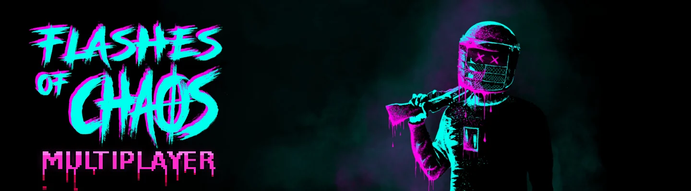
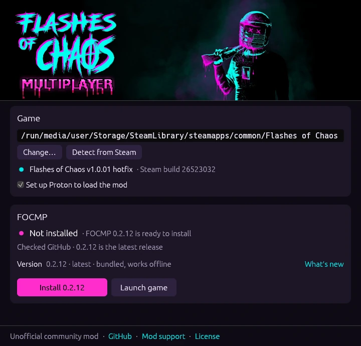

# FOCMP

FOCMP adds three-player online co-op to [Flashes of Chaos](https://store.steampowered.com/app/3399100/) through Steam lobbies. It runs on Windows and on Linux or Steam Deck through Proton, and supports game version **v1.0.01 hotfix**.

It's an unofficial, free community mod and still experimental. [Brainburn Studio](https://brainburnstudio.com/) doesn't support or maintain it.

## Install

> [!WARNING]
> Antivirus software may flag FOCMP, because it loads through a `version.dll` next to the game, a trick some
> malware also uses. Don't trust compiled code blindly: the source is in this repository, releases are built from it
> by [GitHub Actions](https://github.com/ojasookert/focmp/actions), and you can review it or
> [build it yourself](#build).

- Start the game once through Steam and quit it.
- Download the installer for your system from the [latest release](https://github.com/ojasookert/focmp/releases/latest): the `.exe` for Windows, the `.AppImage` for Linux and Steam Deck.
- Run it and press **Install**, then launch the game from Steam as usual.
- Run the installer again whenever you want to update or uninstall. Your saves and settings are kept either way.

If you'd rather install by hand, copy the DLLs and `focmp.ini` from the release ZIP next to `Flashes_of_Chaos.exe`. On Linux, also set the game's launch options in Steam to `WINEDLLOVERRIDES="version=n,b" %command%`.

## Play

Open **COOP**, choose **Host** and invite your friends. Everyone needs their own copy of the game and the same FOCMP version, and has to join before the run starts.

Mod settings live in `focmp.ini` in the game folder. Modded saves are kept apart from your normal ones.

If something goes wrong, [open an issue](https://github.com/ojasookert/focmp/issues) with your FOCMP version, operating system, whether you were hosting or joining, and what happened. Include steps to reproduce it, any error messages, and relevant log files or screenshots if available.

## Known issues

- You can't join a run in progress, reconnect after dropping out, or take over when the host leaves.
- Defend-area objectives aren't synced yet, so their progress can differ between players.
- While the host is in the shop or lab, other players can't damage targets in the hub.
- The ESC menu doesn't pause the game; the world keeps going for everyone.
- Gamepads haven't been tested yet.

## Build

You need Linux with Rustup, MinGW-w64 GCC and Python 3. Run `scripts/build.sh`, then `python3 scripts/package_release.py`. Pushing a `vX.Y.Z` tag builds and publishes a release through GitHub Actions.

## License

The mod and installer are MIT licensed (see [LICENSE](LICENSE)). Flashes of Chaos and its assets belong to Brainburn Studio, including the logo and art shown in `docs/header.webp`, `docs/installer.webp` and the installer's banner and icon. The installer loads that art from your Steam library cache or Steam's CDN rather than bundling it. The MULTIPLAYER lettering is the mod's own, made by `scripts/make_art.py`.
